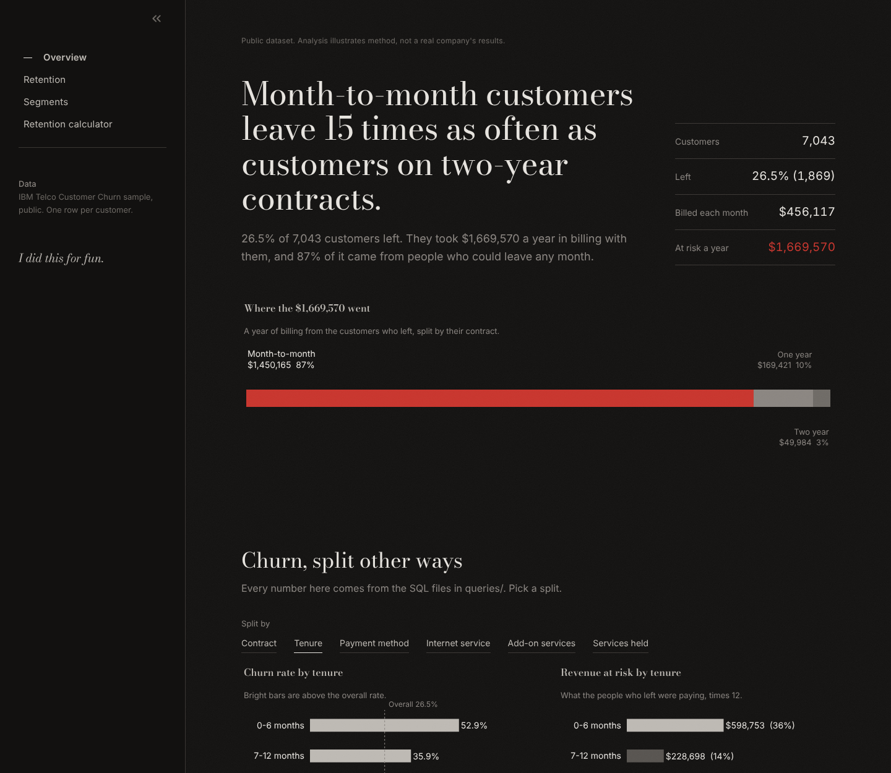
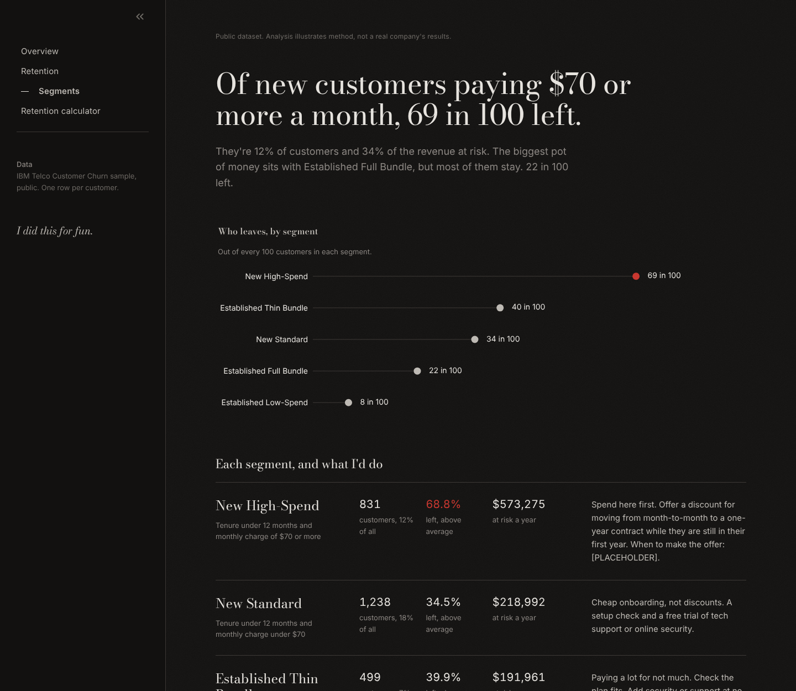
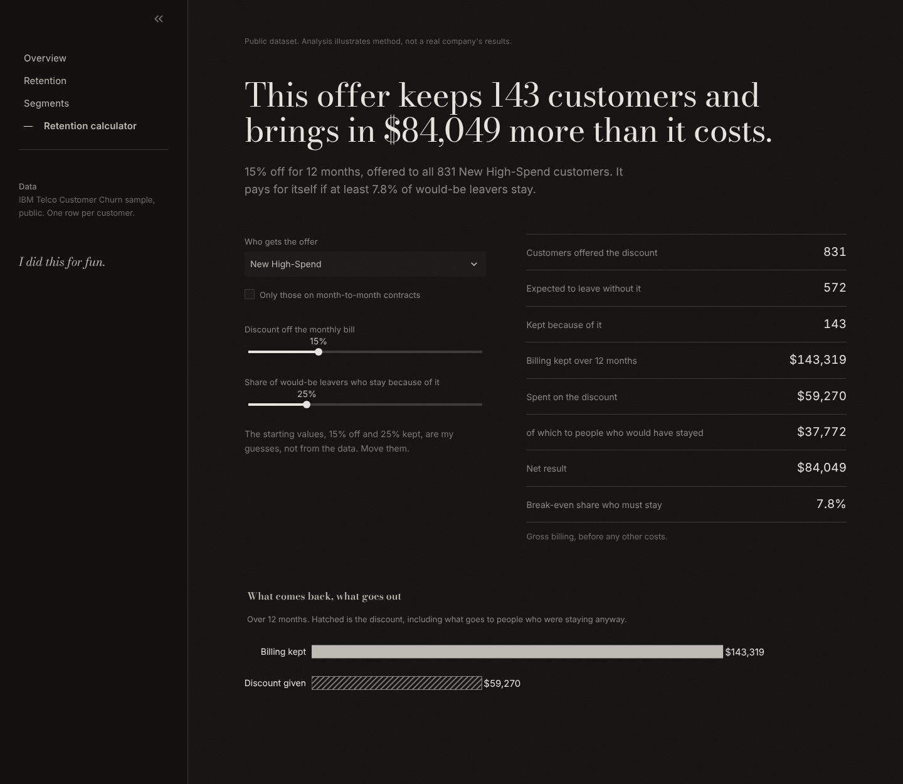

<!-- GENERATED FILE. Edit templates/README.template.md, then run `python run_pipeline.py`.
     Every number below is filled in by code from reports/metrics.json. -->

# Telco churn

Who leaves a phone company, how much money leaves with them, and whether paying to keep them is worth it.

> Public dataset. Analysis illustrates method, not a real company's results.

```bash
pip install -r requirements.txt && python run_pipeline.py && streamlit run app.py
```



## The problem

26.5% of the customers in this data left. Between them they were paying
$139,131 a month, which is $1,669,570 a year.

The obvious move is a discount to keep people. The catch is that nobody knows in advance who
is about to leave, so the discount also goes to people who were staying anyway. I wanted to
know where an offer still pays for itself once you count that.

## What I did

I used the public IBM Telco Customer Churn sample
([Kaggle mirror](https://www.kaggle.com/datasets/blastchar/telco-customer-churn)):
7,043 customers, 21 columns, one row each. It's a teaching dataset, not a real
company's books.

I checked the data before touching it ([full report](reports/audit_report.md)):

| What I found | What I did about it |
|---|---|
| `TotalCharges` stored as text, with 11 blanks, all for customers at 0 months | Set them to 0. They hadn't been billed yet |
| No real nulls. "Missing" meant blank text | Read every column as text first so blanks showed up |
| 0 duplicate IDs, 22 rows identical apart from the ID | Kept them. All new basic-plan customers with the same bill |
| 0 values outside 1.5 x IQR | Removed nothing |
| 99.2% of customers have `TotalCharges` within 20% of tenure x monthly charge | The columns agree with each other |
| Add-ons coded Yes / No / "No internet service" | Kept as is. Add-on numbers only count internet customers |

Then I loaded it into SQLite and did the core work in SQL, one file per question:

| File | Business question |
|---|---|
| `queries/01_overall_churn.sql` | What share of customers churned, and how much recurring revenue left with them? |
| `queries/02_churn_by_contract.sql` | Does contract length change how likely a customer is to leave, and where is the lost revenue concentrated? |
| `queries/03_churn_by_tenure_bucket.sql` | How does churn change over the customer lifetime? Is the first year the danger zone? |
| `queries/04_churn_by_payment_method.sql` | Do customers who pay manually churn more than those on automatic payment? |
| `queries/05_churn_by_internet_service.sql` | Which internet product loses the most customers, and is it the high-revenue one? |
| `queries/06_churn_by_addon_service.sql` | Among internet customers, do those who buy each add-on service churn less than those who do not? |
| `queries/07_churn_by_service_count.sql` | Are customers who hold more services (more engaged) less likely to churn? This informs the engagement axis of the segmentation. |
| `queries/08_retention_curve_overall.sql` | Of every 100 customers who join, how many are still with us after N months? (Survival-style retention by tenure month.) |
| `queries/09_retention_curve_by_contract.sql` | How differently do month-to-month, one-year and two-year customers survive over time? |
| `queries/10_segment_summary.sql` | Which customer segments are largest, which churn most, and where is the most revenue at risk? |
| `queries/11_segment_contract_mix.sql` | What contracts and internet products sit inside each segment? This shapes which retention action fits each one. |

On top of that:

| Step | How | Where |
|---|---|---|
| Retention | Kaplan-Meier survival by month, written as a recursive CTE | `queries/08`, `queries/09` |
| Segments | Five rule-based groups from tenure, monthly bill and number of services | `src/schema.sql`, `queries/10` |
| Model | Plain logistic regression, stratified 25.0% test split, scored on ROC AUC | `src/model.py` |
| Money | Revenue at risk, and a calculator for discount offers | `src/economics.py` |
| Dashboard | Four pages in Streamlit. This README and the memo are generated from the numbers | `app.py`, `pages/`, `src/report.py` |

Every choice and every dead end is in [DECISIONS.md](DECISIONS.md).

How I counted: churn rate is the share of customers marked as gone. Revenue at risk is what
the people who left were paying each month, times 12. Money is billing, not profit, and I'm
assuming US dollars because the data doesn't say.

## What happened

1,869 of 7,043 customers left. That's 30.5% of monthly billing.

Contract length matters most. Month-to-month customers left at 42.7%. One-year, 11.3%.
Two-year, 2.8%. That's 15 times as often on month-to-month, and those
customers are 55.0% of the base and 86.9% of the revenue at risk.

The first year is where it happens. Churn is 52.9% at 0-6 months and
9.5% at 49-72 months. Customers with 12 months or less are
31.0% of the base and 49.6% of the money at risk. Overall,
84.3% are still here after a year and 66.4% after five. After two years, 58.6% of
month-to-month customers remain, against 97.8% on one-year and 100.0% on two-year contracts.

Fiber is the expensive product, and it leaks. Fiber customers left at 41.9%, against
19.0% on DSL and 7.4% with no internet. They pay $92 a month on
average and carry 82.2% of the revenue at risk from 44.0% of customers.

Paying by electronic check goes with leaving: 45.3%, against 15.2%
to 16.7% on automatic payment. Among internet customers, those without online security
left at 41.8%, against 14.6% with it. For tech support it's
41.6% against 15.2%. Streaming add-ons move it by 3.7
points at most.

The segments split risk hard, and the biggest pot of money is not the place to spend.

| Segment | Rule | Customers | Churn rate | Avg monthly charge | Annual revenue at risk | Share of risk |
|---|---|---:|---:|---:|---:|---:|
| New High-Spend | Tenure under 12 months and monthly charge of $70 or more | 831 (11.8%) | 68.8% | $83 | $573,275 | 34.3% |
| New Standard | Tenure under 12 months and monthly charge under $70 | 1,238 (17.6%) | 34.5% | $38 | $218,992 | 13.1% |
| Established Thin Bundle | Tenure 12 months or more, monthly charge of $70 or more, 4 or fewer services | 499 (7.1%) | 39.9% | $80 | $191,961 | 11.5% |
| Established Full Bundle | Tenure 12 months or more, monthly charge of $70 or more, 5 or more services | 2,261 (32.1%) | 22.2% | $95 | $590,536 | 35.4% |
| Established Low-Spend | Tenure 12 months or more and monthly charge under $70 | 2,214 (31.4%) | 7.6% | $38 | $94,806 | 5.7% |

In New High-Spend, 68.8% left. They're 11.8%
of customers and 34.3% of the revenue at risk. Established Full Bundle has the most money
at risk, $590,536, only because it's 47.2% of all revenue. Its churn is
22.2%.

The model backs this up. A plain logistic regression scores a test ROC AUC of 0.845. The one-line
rule "month-to-month means at risk" scores 0.729. In the model's riskiest 10%,
72.9% actually left, against 26.5% on average. The strongest links,
holding the rest equal:

- Contract: Two year (vs Month-to-month): odds of churning 72% lower
- Internet service: Fiber optic (vs DSL): odds of churning 2.43x higher
- Internet service: No (vs DSL): odds of churning 58% lower
- Contract: One year (vs Month-to-month): odds of churning 50% lower
- Uses paperless billing: odds of churning 1.50x higher
- Has online security: odds of churning 33% lower



## What I'd do

Test a contract-upgrade offer on New High-Spend, against a holdout group that gets nothing.

With my starting guesses (15% off for 12 months, 25% of
would-be leavers kept, everyone offered takes it):

| New High-Spend: 831 customers, 68.8% churn | |
|---|---:|
| Customers kept | 143 |
| Billing kept over 12 months | $143,319 |
| Spent on the discount ($37,772 of it to people staying anyway) | $59,270 |
| Net result | $84,049 |
| Break-even share who must stay | 7.8% |

The same offer on every segment:

| Target segment | Customers saved | Revenue saved | Discount cost | Net benefit | Break-even save rate |
|---|---:|---:|---:|---:|---:|
| New High-Spend | 143 | $143,319 | $59,270 | $84,049 | 7.8% |
| New Standard | 107 | $54,748 | $60,364 | -$5,616 | 28.0% |
| Established Thin Bundle | 50 | $47,990 | $50,403 | -$2,412 | 26.5% |
| Established Full Bundle | 126 | $147,634 | $320,755 | -$173,121 | 59.5% |
| Established Low-Spend | 42 | $23,702 | $142,392 | -$118,690 | not reachable |

Only 1 segment makes money. In Established Full Bundle, the discount handed to people
who were staying anyway comes to $298,610, which sinks it to -$173,121.
It would need 59.5% of would-be leavers to stay just to break even. Aiming at its
860 month-to-month customers only gets it to roughly break-even ($521).
For that group I'd skip the discount and look after them instead.



## What this can't tell you

- It's a public teaching sample. The patterns show the method, not a real market.
- It shows what goes together, not what causes what. Moving someone onto a longer contract may not keep
  them the way it keeps people who chose one.
- It's one snapshot with no dates. The retention curve assumes people who joined years ago behaved like
  people who joined last month. Read literally, the churn flag ("left within the last month") doesn't fit
  the tenure numbers. DECISIONS.md, Stage 4, has the detail.
- The save rate is a guess, and the recommendation leans on it. The break-even rate shows the margin for
  error. Only a test gives the real number.
- It's billing, not profit. There's no cost data, so both sides of the sum would shrink with real margins.
- The model is a baseline. No tuning, no confidence intervals, one split. I left monthly charge out because
  the services held explain it almost entirely (R-squared 0.999).

## With more data

- Join, churn and plan-change dates, to follow real groups of customers over time.
- A proper test: offer against holdout, to measure the save rate instead of guessing it.
- Margin and cost to serve by product, so the calculator gives profit.
- Support tickets, outages and price changes, to see why fiber customers leave.
- Once there's test data, rank people by how much the offer changes what they do, not just by risk.

## Running it

```
run_pipeline.py      audit, clean, SQLite, SQL, retention, segments, model, money, docs
app.py, pages/       the dashboard: Overview, Retention, Segments, Retention calculator
queries/             one SQL file per question
src/                 pipeline code; schema.sql holds the segment rules
templates/           README and memo templates, numbers filled in by code
reports/             audit report, metrics.json, every query result as CSV
tests/               data checks, SQL checks, money maths, claim checks, page loads
assets/style.css     the look; assets/screenshots/ for this README
static/fonts/        Bodoni Moda (OFL) and TeX Gyre Heros (GUST), the Helvetica Neue fallback
scripts/canary.py    one command that checks the whole thing from a clean copy
DECISIONS.md         what I chose, what I dropped, and why
memo.md              one page for a manager
```

`pytest -q` runs the tests. `python scripts/canary.py` copies the repo without generated files, runs the
pipeline and tests, then clicks through every dashboard page in a headless browser and checks the numbers
on screen against `reports/metrics.json`. `python scripts/take_screenshots.py` refreshes the screenshots
while the app is running. Both scripts need Playwright, which I kept out of `requirements.txt`
(`pip install playwright && playwright install chromium`). Generated 2026-10-11.

## Talking points

### The question
I asked where a retention offer pays for itself, not just who's likely to leave. A churn score
doesn't tell you what to spend.

### The audit
`TotalCharges` was text with blanks, and every blank was a customer at zero months, so I set them to zero
instead of dropping or guessing. I read everything as text first and put a schema check in front, so bad
input stops the pipeline.

### The SQL
Each question is its own SQL file with the question written at the top, using CTEs, CASE buckets and window
functions. Every split is tested to add back up to the totals.

### Retention
I used Kaplan-Meier, written as a recursive CTE, after the literal reading of the churn flag said almost
nobody lasts a year. Curves stop where fewer than 30 customers are left, so noise doesn't pass
for a trend.

### Segments
I adapted RFM to tenure, monthly bill and number of services, using plain thresholds instead of quantiles,
because ties in tenure made quantile cuts arbitrary. Five segments, each with one rule and one action.

### The model
A plain logistic regression scored 0.845 against 0.729 for a one-line contract rule,
and I show both so the gain is clear. I dropped monthly charge once I saw it was nearly the sum of the
services and was flipping signs.

### The money
The calculator charges the discount to everyone in the group, including people who were staying anyway,
because that's how offers work. That one detail is why the segment with the most money at risk is the wrong
place to discount.

### What I'd do and where it's weak
I'd test a contract-upgrade offer on New High-Spend against a holdout, because it breaks even at
7.8%. It's a public sample, the save rate is a guess, and none of it proves cause.
